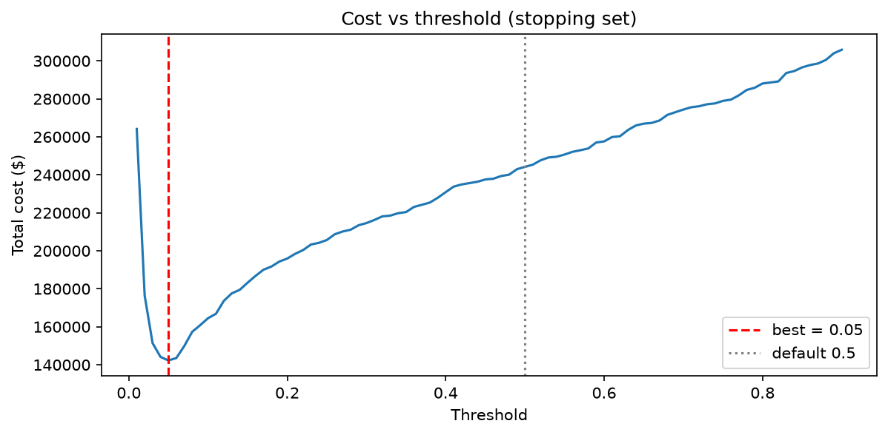
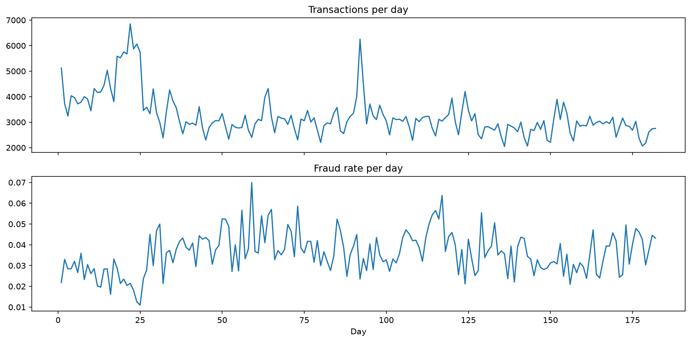
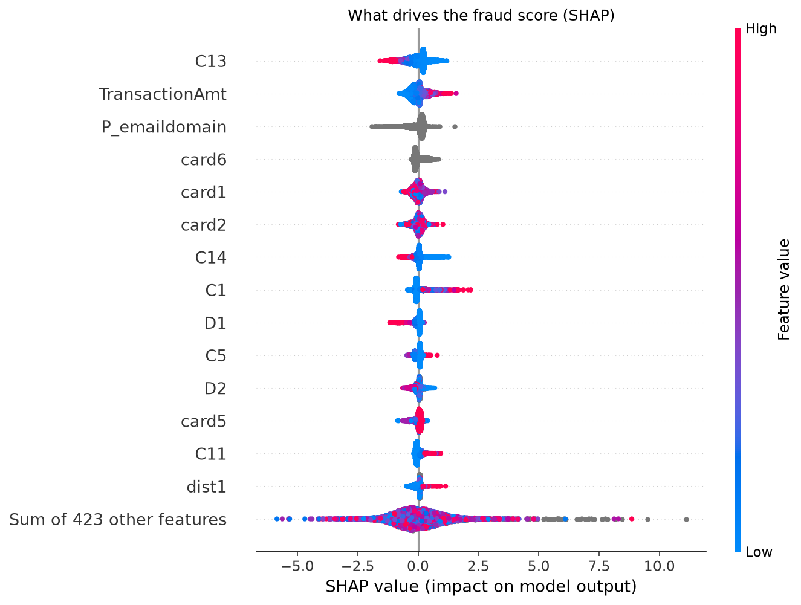
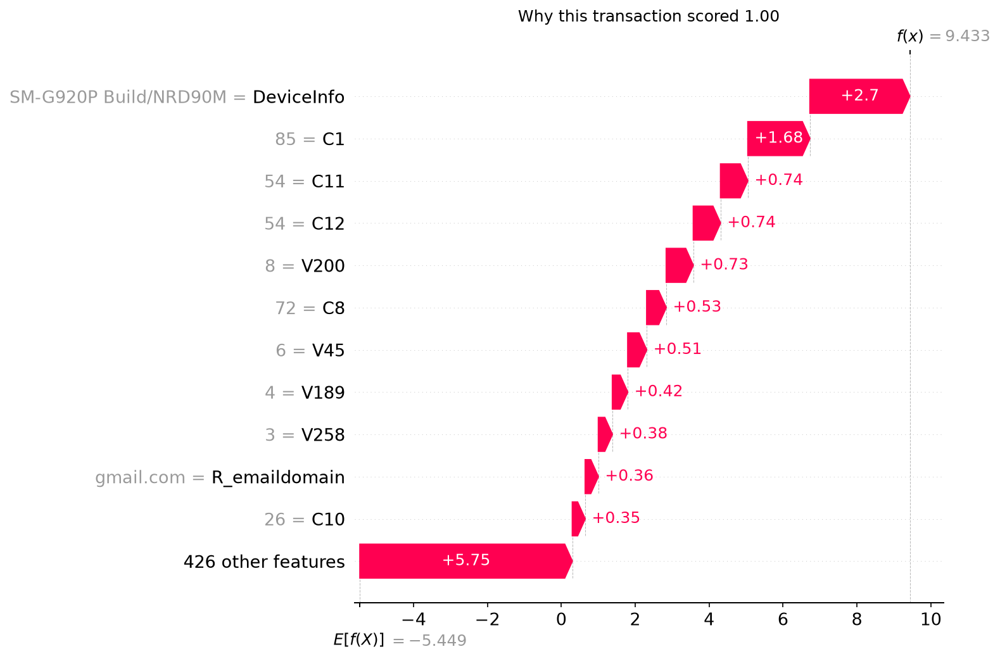
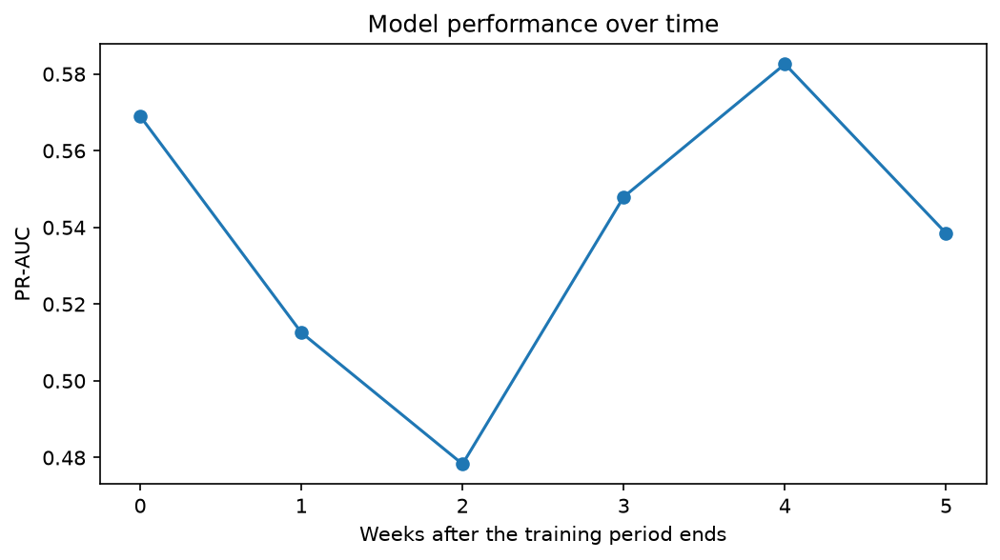

# Fraud Detection with Cost-Based Decisions

Predicting card-not-present fraud on 590,000 real e-commerce transactions, then turning the model's scores into block/approve decisions that cut fraud losses by about half.

Data: [IEEE-CIS Fraud Detection](https://www.kaggle.com/c/ieee-fraud-detection) (Vesta Corporation). About 3.5% of transactions are fraud.

## Headline results

| Rule | Fraud caught | Precision | Total cost (36 days) |
|---|---|---|---|
| Approve everything | 0% | n/a | $580,714 |
| Model, default threshold 0.5 | 33% | 81% | $453,207 |
| **Model, cost-optimal threshold 0.05** | **65%** | **31%** | **$298,888** |

Same model, different threshold: the cost-based cutoff saves about $154k more than the default over the validation period, and 49% compared with having no model.



## Why this project is set up the way it is

### 1. Time-based validation, not a random split

`TransactionDT` covers 181 days. The fraud rate is not stable over that period: it sits near 2 to 3% early on, dips during a high-volume spell, then settles around 4%.



A random split would let the model train on day 170 and be tested on day 40, and would put transactions from the same stolen card on both sides. Both inflate the score. Instead:

- **Train:** days 1 to 140
- **Gap:** days 141 to 146 dropped, so fraud runs don't spill across the boundary
- **Validation:** days 147 to 182

Every learned quantity (medians, scaling, category lists, early stopping, the threshold) comes from training data only.

### 2. PR-AUC, not accuracy

A model that never predicts fraud is 96.5% accurate. I report ROC-AUC because people expect it, but I judge models on PR-AUC, where random guessing scores about 0.034.

## Model results

| Model | PR-AUC | ROC-AUC |
|---|---|---|
| Random | 0.034 | 0.50 |
| Logistic regression (median impute + missing flags) | 0.187 | 0.823 |
| LightGBM, raw features (3-seed mean) | 0.538 | 0.90 |
| LightGBM + card-history features (3-seed mean) | 0.540 | 0.90 |

LightGBM gets close to three times the baseline's PR-AUC, mostly because it handles missing values natively and picks up non-linear patterns. Fraud amounts cluster at both ends of the range (small card-testing charges and larger purchases), which a linear model can't capture without help.

## What didn't work, and why

I rebuilt an approximate card-holder ID from `card1`, `addr1` and the card's start date (`day - D1`), then added past-only behaviour features: prior transaction count, hours since the last transaction, and amount relative to that card's history.

A single run suggested these features made the model worse (0.545 to 0.537). Running each version with three seeds showed the difference was noise: 0.538 vs 0.540. The first 0.545 was a lucky seed.

Why they added nothing:

- **Most cards appear once.** The median ID has one transaction in six months, so there's no history to use.
- **Vesta already did this.** The top features are the `C` count columns (`C1`, `C13`, `C14`), which capture card history better than my rebuild.
- **A pandas 3 change hid a bug.** `.astype(str)` now keeps missing values missing, so 11.3% of rows got no ID at all.

The lesson I took from this: never compare models on a single run when the gap is small.

## Missing data is a signal

| Missing field | Fraud rate when missing | When present |
|---|---|---|
| Device / identity data | 2.1% | 7.8% |
| Billing address | 11.6% | 2.5% |

The two go in opposite directions. Device data is mostly collected on riskier online payments, so its absence means lower risk. A missing billing address means much higher risk. Dropping sparse columns or filling them with the mean would have thrown this away.

## Explaining decisions with SHAP



The strongest drivers are the linked-entity counts (`C13`, `C14`, `C1`), transaction amount, the buyer's email domain, credit vs debit, and how new the card is. All of these make business sense.



The highest-scoring fraud in the sample was flagged mainly because of a specific phone model (`DeviceInfo`) and a card linked to 85 addresses, where most cards have one or two.

**A caution:** one device model being the top reason suggests the model has memorised a fraud ring's phone. That breaks when the fraudster switches devices, and it could flag innocent owners of the same model. A next step would be to test the model without `DeviceInfo`.

## Drift



- **Inputs are stable.** Every top feature has a PSI below 0.05 between training and validation.
- **Performance still drops.** The early-stopping window (days 121 to 140) scored 0.66 PR-AUC, the validation period about 0.54, and weekly scores bounce between 0.48 and 0.58.

So the transactions look the same, but the link between them and fraud has shifted. That's concept drift, and PSI can't detect it on its own. In production, labels arrive weeks later through chargebacks, so monitoring needs both PSI as an early warning and label-based checks once outcomes are known.

## Limitations

- **Costs are assumptions:** $20 per false alarm, and the transaction amount plus $15 per missed fraud. The method holds, but the exact threshold would change with real figures.
- **Review capacity:** the optimal threshold flags about 200 transactions a day. If a review team can't handle that, the right threshold is the cheapest one within their capacity.
- **Calibration:** the cost-optimal threshold (0.05) is well below the break-even value worked out by hand (about 0.18), which suggests the model's probabilities run low. Ranking isn't affected, but the scores shouldn't be read as literal probabilities without calibration.
- **Labels:** Vesta propagated fraud labels to linked later transactions, so some patterns the model learns come from how the data was labelled.

## Deployment: from notebook to service

[](https://github.com/annu-banerjee/fraud-detection/actions)

The research model uses 432 features. No real system sends 432 fields per payment, so `src/train.py` ranks features with the full model and retrains a compact one.

| Model | Features | PR-AUC | Cost over 36 days |
|---|---|---|---|
| Full | 432 | 0.545 | ~$299k |
| Compact | 30 | 0.499 | $357k |
| **Compact (deployed)** | **60** | **0.533** | **$307k** |

60 features keep 98% of the PR-AUC for 14% of the inputs.

**What's in the service**

- **FastAPI** (`src/api.py`): `/predict` returns a fraud score, a block/approve decision at the cost-optimal threshold, and the top three reasons from LightGBM's built-in SHAP values. Bad input (unknown fields, text in number fields) is rejected with a clear error. Missing values and unseen categories are allowed and counted.
- **Tests** (`tests/`): 11 pytest checks, including regression tests on a known fraud and a known legit transaction.
- **Docker**: Python 3.12 slim image, non-root user, health check. Gives the same score as the local model.
- **CI** (GitHub Actions): every push runs the tests, builds the image, starts the container and sends it a real transaction.
- **Monitoring**: every prediction is logged with a request ID and latency. `/monitor` reports block rate, p95 latency and a PSI check of live scores against the training distribution.

**A bug the tests caught.** After retraining, five tests failed with 422 errors. Multithreaded LightGBM training is not deterministic by default, so a near-tie in feature importance swapped which features made the top 60, and the stored example requests no longer matched. I made training deterministic (`deterministic`, `force_row_wise`, fixed thread count) and regenerated the fixtures. Retraining now produces a byte-identical model.

**What monitoring can and can't see.** I replayed real validation traffic through the API:

| Replayed week | Real frauds in 500 | Caught | Block rate | Score PSI |
|---|---|---|---|---|
| Week 0 | 13 | 6 | 7.6% | 0.015 (stable) |
| Week 4 | 31 | 19 | 7.7% | 0.026 (stable) |

Fraud more than doubled between the two weeks, yet the block rate and score distribution barely moved, and PSI stayed "stable". Label-free monitoring only sees inputs and scores. It can't tell that the share of fraud underneath has changed. That's the same concept-drift finding as the research section, now shown in a running system. The samples are small (13 and 31 frauds), so the catch rates are noisy, but the blind spot is the point.

**Run it locally**

```bash
pip install -r requirements.txt
python src/train.py          # needs data/processed/*.parquet from the notebooks
uvicorn src.api:app          # docs at http://127.0.0.1:8000/docs
pytest -v
```

Or with Docker:

```bash
docker build -t fraud-api .
docker run -d -p 8000:8000 fraud-api
curl -X POST http://127.0.0.1:8000/predict -H "Content-Type: application/json" -d @examples/fraud_example.json
```

## Next steps

- Calibrate probabilities (isotonic regression) and use a per-transaction rule: flag when expected loss exceeds review cost
- Retrain without `DeviceInfo` and compare
- Add label-based monitoring that joins chargebacks back to logged request IDs once outcomes arrive

## Project structure

```
fraud-detection/
├── notebooks/
│   ├── 01_eda.ipynb
│   └── 02_baseline.ipynb          # baseline, LightGBM, threshold, SHAP, drift
├── src/
│   ├── train.py                   # reproducible training of the deployed model
│   ├── api.py                     # FastAPI service with logging and /monitor
│   ├── make_examples.py           # real transactions saved as test requests
│   └── replay.py                  # sends validation traffic to the running API
├── tests/test_api.py
├── models/                        # deployed model + metadata
├── examples/                      # sample requests
├── figures/  results/
├── Dockerfile  requirements.txt  .github/workflows/ci.yml
├── data/                          # not committed; download from Kaggle
└── README.md
```

## How to run

```bash
python3 -m venv .venv
source .venv/bin/activate
pip install pandas numpy scikit-learn lightgbm shap matplotlib seaborn jupyter pyarrow
# macOS only: brew install libomp
```

Download `train_transaction.csv` and `train_identity.csv` from Kaggle into `data/raw/`, then run the notebooks in order.
